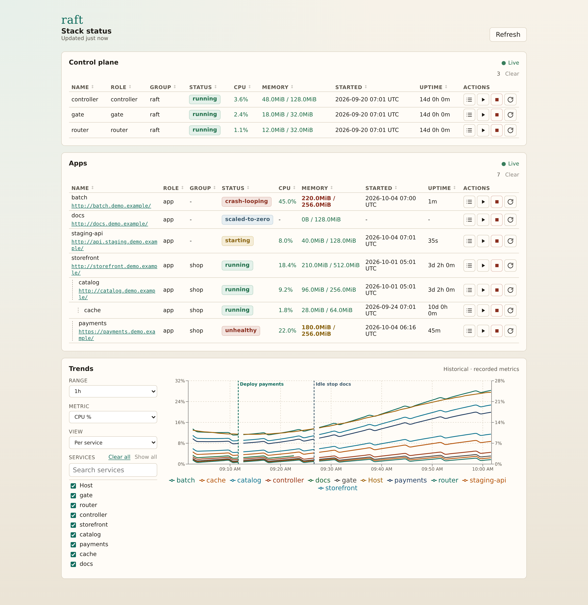
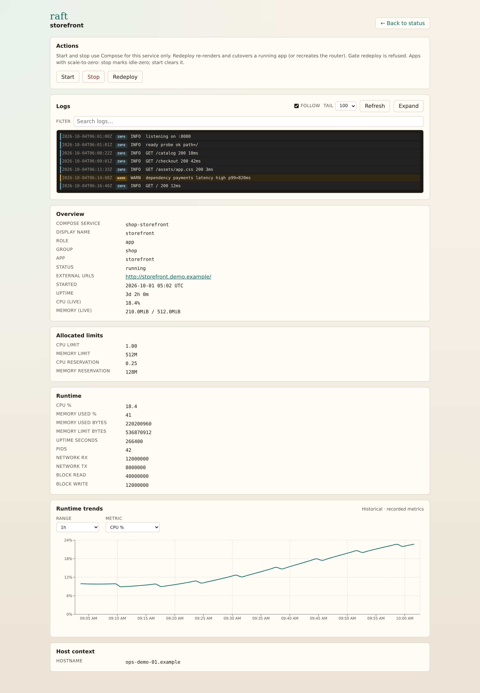

# raft

**Deploy like you have a control plane — without running Kubernetes.**

raft sits between a full cluster and hand-rolled Docker Compose + nginx. You describe each service in `.raft/app.yaml`; raft turns that desired state into Compose and nginx artifacts, then deploys and cutovers them on a single VPS — light on resources, heavy on operator UX.

<p align="center">
 <video src="https://github.com/user-attachments/assets/c0f96eeb-8654-469e-8981-cfa7e0fb067e" controls width="900"></video>
</p>

<p align="center">
 
</p>

<p align="center"><em>Localhost ops UI — live status, actions, and resource trends for the edge and every applied app.</em></p>

## The problem

Kubernetes is real infrastructure. On a solo VPS it is usually more platform than product.

Raw Compose and nginx get you online fast — until Host routing, TLS, multi-app stacks, and safe releases become a second job you maintain by hand.

## What raft is

A small control plane on your host: a public **gate**, an inner **router**, and your **apps**. Traffic hits the gate, the router sends it by `Host`, and each applied App runs as its own Compose service.

You keep services in their own repos. On the VPS you `apply` a manifest. raft syncs sources, regenerates the Compose/nginx artifacts under `~/.raft/`, and cutovers the running service — without taking the public edge down for a normal release.

## What you get

- **One ship command** — `raft apply` registers desired state and deploys (first boot and later releases)
- **Managed artifacts** — Compose apps, upstreams, and gate/router nginx are generated for you, not edited by hand each release
- **Adaptive manifests** — apply-time `${VAR}` / `${{ if }}` and `--env` so one `.raft/app.yaml` can serve stages
- **Safer cutovers** — tmp cutover + router reload; published edge ports only need `raft redeploy gate`
- **Operator feedback** — `raft doctor` with fix hints; `raft status` / `raft logs` for the live plane
- **Localhost ops UI** — `raft serve` for tables, actions, logs, trends, and edge access control (never on the public gate)
- **Optional scale-to-zero and healing** — idle-stop/wake when you declare `spec.scaling`; healing stays in settings

## Features

| Capability | Status |
|------------|--------|
| Desired-state deploys from App manifests (safe cutovers on one VPS) | ✅ |
| Managed public edge (TLS, Host routing, multi-app stacks) | ✅ |
| Scale-to-zero and healing | ✅ |
| Localhost ops console (status, actions, logs, trends, request inspection) | ✅ |
| GitHub-assisted add service | ✅ |
| Operator notifications | ✅ |
| Ordered edge firewall (rich rules, import/export) | ✅ |
| Alert rules (metrics/control-plane → notifications) + default setup recommendations | ✅ |
| GitOps-first host config (flat YAML + temporary serve/CLI overrides) | ✅ |
| RBAC via `rbac.yaml` (oauth/external + password usernames) | ✅ |
| Operator system event timeline (CLI + serve) | ✅ |
| Always-on dashboard Compose service (`raft-dashboard`) | ✅ |
| Firewall-derived alert signals | 📋 |
| Deeper secrets isolation (external stores → per-App materialization) | 📋 |
| Trends dashboards (multi-graph, browser-local; editable graphs + named dashboards) | ✅ |
| Per-service Trends (default editable graphs on inspection, browser-local) | ✅ |
| Reusable dashboard kit (Trends overview embed; browser-local) | ✅ |

✅ shipped · 🚧 in progress · 📋 planned

## Try it

Needs **Python 3.11+**, Docker, and Compose.

```bash
curl -fsSL https://raw.githubusercontent.com/danielnachumdev/raft/main/install.sh | bash
# pin a ref (tag / branch / sha) instead of the latest Release wheel:
# curl -fsSL …/install.sh | bash -s -- --ref main
```

Operator data lives under **`~/.raft/`** (override with `RAFT_DATA_HOME`). Copy ideas from [`examples/settings.yaml`](examples/settings.yaml) into `~/.raft/host/settings.yaml`.

**TLS:** browser → VPS directly → `tls: acme` (Let's Encrypt HTTP-01 on the gate; set DNS A/AAAA, open 80/443, and `acme.email` — no PEMs to paste). Behind Cloudflare Origin (or similar) → `tls: origin` (install `origin.{pem,key}` under `~/.raft/services/<app>/certs/` before deploy).

```bash
raft doctor
raft apply --file .raft/app.yaml --ref "$SHA"
# or: raft apply --git git@github.com:org/my-site.git --ref "$SHA"
raft status
```

Copy-paste scenarios live in [`examples/`](examples/) (richest field comments in `examples/http-only-site/`).

Later: `raft update` to refresh the CLI, `raft uninstall --yes` to remove everything.

## How a release feels

CI (or you) points at a commit and applies:

```bash
raft apply --file .raft/app.yaml --ref "$SHA"
```

Same command for first boot and later cutovers. raft syncs, renders, and switches traffic through the router. Changing published edge listeners in settings is the exception — that needs `raft redeploy gate` (brief edge downtime).

## Ops UI

When a terminal snapshot is not enough, run **`raft serve`**. One localhost process: live tables, quick actions, logs, and trends. It never listens on the public gate — open it on the host, or forward `127.0.0.1:8787` from wherever you operate.

<p align="center">
 
</p>

<p align="center"><em>Service detail — actions, follow logs, overview, limits, and historical runtime charts.</em></p>

```bash
raft serve # http://127.0.0.1:8787/
raft serve --stop
```

## Common commands

| Command | When |
|---------|------|
| `raft apply --file …` / `--git …` | Register + deploy (default path) |
| `raft doctor` | Health check + fix hints |
| `raft status` | CPU/memory snapshot (`--live` to watch) |
| `raft serve` | Localhost ops dashboard (default `:8787`) |
| `raft logs [name…]` | Container stdout/stderr (`-f` to follow) |
| `raft up` / `raft down` | Power existing images (optional `up --build`); with `NAME` = per-service (down stops, does not remove) |
| `raft redeploy <name>` | Refresh a running app, router, dashboard, controller, or **gate** (edge ports; brief downtime) |
| `raft sync` / `raft render` | Pipeline only (sources / Compose+nginx); not substitutes for redeploy |
| `raft firewall …` | Ordered gate rules (`host/firewall.yaml`); Save/CLI → reload, never recreate |
| `raft alerts …` | Alert rules (`host/alerts.yaml`) → notification channels |
| `raft notifications …` | Notification destinations (`host/notifications.yaml`) CRUD + test-send |

### GitOps host config (durable SoT)

On hosts that reconcile from an ops repo (Sync host config), durable operator config is **flat YAML in Git**, copied onto `~/.raft/host/`:

| File | Role |
|------|------|
| `settings.yaml` | Host settings (`RaftConfig`) |
| `firewall.yaml` | Ordered edge firewall |
| `alerts.yaml` | Alert rules (+ optional `disable_tips: true`) |
| `notifications.yaml` | Notification destinations |
| `rbac.yaml` | RBAC roles/bindings (when enabled) |

**Durable edit path:** change the file in the ops repo → PR → Sync on the host → `raft render` / nginx reload (or process restart so `@lru_cache` drops) → verify with `raft doctor` / serve UI / CLI show.

**Temporary host override:** serve Save and config CLI mutators (`raft firewall|alerts|notifications …`, Settings Save, GitHub OAuth save) **may write** the live host file for live testing. The next Sync **overwrites** that file from Git — click-ops is not durable SoT. UI banners and CLI warnings say so. Runtime ops (`up` / `down` / `redeploy` / logs) stay mutative and are not GitOps docs.

**Apps** stay `raft apply` (CI or local). Secrets/PEMs/checkouts/metrics JSONL/`generated/` stay host-local (not the GitOps config SoT). Tips dismissal is temporary unless you set `disable_tips: true` on the firewall/alerts doc in Git.

### Lifecycle glossary

| Verb | Meaning |
|------|---------|
| **up** / **down** | Power: stack (no args) or one service (`NAME`). Per-service down = Compose stop, not remove. |
| **redeploy** | Generation refresh / cutover for a running unit. Includes `gate` (container recreate). |
| **sync** | Clone/update sources for applied apps. Does not cut over traffic by itself. |
| **render** | Regenerate Compose/nginx under `~/.raft/`. May reload nginx; does not replace redeploy. |
| **reload** | Automatic side effect of render / firewall Save — not a separate operator verb. |

## Upgrade notes

### GitOps-first host config (#310)

If this host Syncs config from an ops repo:

1. Keep durable edits in Git (`settings.yaml`, `firewall.yaml`, `alerts.yaml`, `notifications.yaml`, …) — not only on the live VPS.
2. After Sync: `raft render` (and restart serve/controller if cached reads look stale), then `raft doctor`.
3. Treat serve/CLI Save as a **temporary host override** until the same change is in Git; the next Sync replaces the host file.
4. Move notification channels into `host/notifications.yaml` (no longer nested under `settings.yaml`).
5. Prefer `disable_tips: true` on firewall/alerts docs in Git over relying on tip dismiss alone.

SQLite (`raft.sqlite`) and full read-only UI/CLI are **not** the config SoT model.

### Breaking removals (#312)

When upgrading across the #312 cleanup (flat ACL / install aliases / access-log parse):

1. **Backup** `~/.raft/` (especially `host/settings.yaml`, `host/firewall.yaml`, `host/alerts.yaml`, `host/notifications.yaml`, `services/`).
2. **Before upgrade** (recommended): open serve **Firewall** and **Save** once so `host/firewall.yaml` exists. Flat ACL migrate-on-load is gone — leftover `acl.gate` / `state/acl/` is ignored.
3. **Upgrade** (`raft update` / install from the latest Release wheel). Replace automation that used **`RAFT_BRANCH`** with **`RAFT_REF`** / `--ref`.
4. Re-save **Settings** once (drops any leftover `acl:` key). GitHub assist uses OAuth accounts only (`host/serve/github-accounts.json`; old `github-session.json` is not migrated — re-login if needed).
5. **Access logs:** gate HTTP inspection parses the current `raft_http` line shape. Rotate or wipe old gate access-log files under `~/.raft/` if short non-matching lines remain (they are skipped).
6. Trends: only `raft-serve-trends-dashboards` is read; clear stale `raft-serve-trends-views` localStorage if desired.
7. Run **`raft doctor`** / **`raft status`**; prefer gate **reload** unless published edge ports changed (`raft redeploy gate`).

## Develop

```bash
git clone https://github.com/danielnachumdev/raft.git && cd raft
uv sync --extra dev
uv run pytest
uv run raft -- --help
```

CI runs the suite across Python 3.11–3.13. Dashboard source is in **`src/spa/`** (Release CD bakes into `share/serve/spa/` inside the wheel; hashed assets are not committed).

Changing the product? **[AGENTS.md](AGENTS.md)** is the implementation guide (architecture invariants, packaging pitfalls, planned vs shipped detail). Operator manifest samples: [`examples/`](examples/).

## License

raft is dual-licensed (see [`LICENSING.md`](LICENSING.md)):

- **AGPL-3.0** — free under copyleft terms ([`LICENSE`](LICENSE))
- **Commercial** — paid option for closed-source use; contact the maintainer for details ([`LICENSE-COMMERCIAL.md`](LICENSE-COMMERCIAL.md))

Docker and nginx remain under their own licenses; they are not relicensed by raft.
